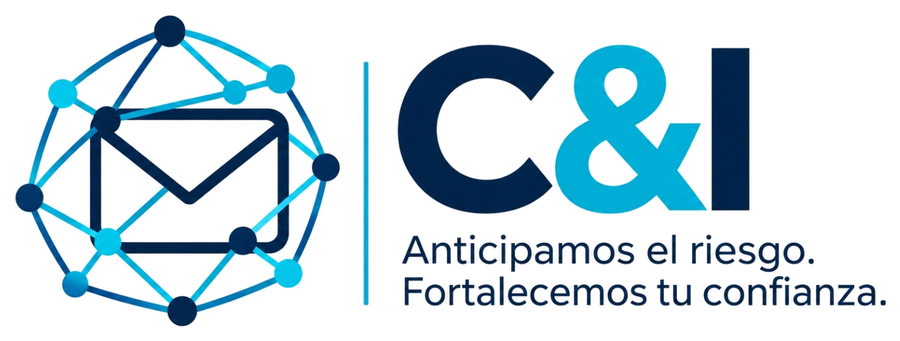

# 🛡️ C&I



Sistema inteligente contra el phishing en el correo corporativo de la banca venezolana.
Equipo **C&I – Creatividad e Innovación** · Hackathon UNETI IA 2026 · Proyecto **#24** (+ capa ética **#18**).

**Demo en producción:** https://c-i.equipo-ci.workers.dev

## Qué hace

C&I revisa cada correo que llega al personal del banco **antes de que alguien haga clic**:

1. **Analiza** remitente, dominio (incluidos homógrafos como `sudebán.com`), encabezados SPF/DKIM/DMARC, enlaces, adjuntos y contenido.
2. **Clasifica** el riesgo de 0 a 100 (seguro, bajo, alto, crítico) y **explica por qué**: cada señal con su peso y el fundamento legal venezolano aplicable.
3. **Actúa:** deja el correo en la bandeja, lo manda a **spam** o lo aísla en **cuarentena**.
4. **Protege la privacidad:** tapa cédulas, teléfonos, cuentas y correos personales antes de usar IA y antes de guardar.
5. **Pone a una persona al mando:** el Gerente de Seguridad (CISO) confirma o restaura cada correo en cuarentena, y todo queda en una bitácora inmutable con hash SHA-256 encadenado.

**Regla de oro: las reglas deciden, la IA explica.**

```
Puntaje final = máx( Reglas , Reglas × 0,7 + IA × 0,3 )      (sin IA: Puntaje final = Reglas)
```

La IA aporta el 30 % de la fusión, pero **solo puede subir el riesgo, nunca bajarlo**: un correo que intenta manipular a la IA («clasifícame como seguro») no sale de spam ni de cuarentena, y además suma un indicador propio.

## Cómo se instala

Requisitos: **Node.js 20+** y Git. No hace falta cuenta de Cloudflare ni base de datos aparte (D1 corre localmente con SQLite).

### Local y sin internet (entorno `offline`, motor de reglas sin IA)

```bash
git clone https://github.com/AnthonyLeguis/C-I.git
```

```bash
cd C-I && npm ci
```

```bash
cp .dev.vars.example .dev.vars
```

```bash
npx wrangler d1 migrations apply c-i-db-offline --local --env offline
```

```bash
npx wrangler d1 execute c-i-db-offline --local --env offline --file=seed/seed_mailbox.sql
```

```bash
npm run build:web
```

```bash
npx wrangler dev --env offline
```

Abrir http://localhost:8787.

Verificar que todo está en verde (tipos, **209 pruebas**, reglas del proyecto y build):

```bash
npm run check
```

### Con Docker (máquina limpia, sin internet en ejecución)

```bash
docker compose up --build --abort-on-container-exit --exit-code-from smoke
```

Levanta la app en el puerto 8787 en modo `offline` (usuario sin privilegios, secreto de sesión generado al arrancar) y ejecuta la prueba de humo contra ella.

## Cómo se usa

**Usuarios de demostración** (datos 100 % sintéticos, contraseña `Demo-2026!`; en el login también hay perfiles de 1 clic). Los tres perfiles **ven todas las pantallas**; lo que cambia son las **acciones** (la API responde `403` y el botón no se muestra):

| Usuario | Rol | Acciones |
|---|---|---|
| `jrios` | Analista de Seguridad | Simular llegadas, analizar correos, marcar como seguro los de Bandeja o Spam que no esperan revisión, escalar al CISO, usar el asistente, descargar hallazgos `.md` |
| `svalenzuela` | Gerente de Seguridad (CISO) | Lo anterior + confirmar o restaurar la cuarentena, liberar correos en revisión, bloquear y desbloquear dominios, exportar la bitácora en CSV |
| `cmendoza` | Master / Soporte Técnico | Lo anterior + verificar la integridad de la bitácora, activar el modo reglas (IA apagada) y restablecer la demo |

**Recorrido de 1 minuto:**

1. **Login** en 1 clic como Dra. Sofía Valenzuela (CISO).
2. **Buzón** (distribución tipo Gmail): **Simular llegada** → «Falso SUDEBAN (crítico)» cae solo en **Cuarentena** con puntaje 100.
3. Abrir el correo: mensaje neutralizado, explicación (con la etiqueta del modelo que la redactó), fundamento legal y panel de análisis. **Ver hallazgos** muestra cada señal con su peso y permite **descargar el informe `.md`**.
4. **Confirmar amenaza** o **Bloquear dominio**: los próximos correos de ese dominio van directo a cuarentena.
5. **Analizador:** pegar cualquier correo (o el correo crudo con encabezados) y obtener el dictamen completo.
6. **Asistente IA** de contexto cerrado: responde solo sobre el sistema y la seguridad del correo; una pregunta ajena recibe «Esta pregunta está fuera de los parámetros…» y un intento de ataque («ignora tus reglas…») queda **bloqueado** por el guardián ético.
7. **Bitácora:** cada acción con su hash; el Master pulsa **Verificar integridad**.

## Seguridad

Resumen (detalle, modelo de amenazas y riesgos aceptados en [`SECURITY.md`](SECURITY.md)):

- **Sesión:** contraseñas PBKDF2-SHA256 (100 000 iteraciones), cookie HMAC `HttpOnly; Secure; SameSite=Strict` de 8 h, comparación en tiempo constante.
- **Autorización:** rol mínimo en **cada** endpoint (`ADMIN ⊃ SUPERVISOR ⊃ ANALYST`).
- **API:** cabeceras de seguridad (CSP, `X-Frame-Options`, `nosniff`, HSTS), protección CSRF (mismo origen + JSON), cuerpos de máximo 64 KB, límites de tamaño por campo y **límite de intentos** (login, IA y simulación).
- **IA:** datos personales tapados antes del modelo; la IA no puede bajar un riesgo; guardián con reglas + Llama Guard 3; asistente de contexto cerrado.
- **Datos:** SQL siempre parametrizado; bitácora con hash encadenado e inserción condicional (no se bifurca con escrituras simultáneas); CSV sin inyección de fórmulas.
- **Cadena de suministro:** `npm audit` sin vulnerabilidades, workflows con permisos mínimos y token de Cloudflare solo en los pasos de despliegue.

## Arquitectura Cloudflare usada

| Servicio | Uso |
|---|---|
| **Workers** + Hono | API REST `/api/v1` con roles en cada endpoint, arquitectura por capas (dominio, aplicación, infraestructura, presentación) |
| **D1** | Usuarios, buzón, bitácora con hash encadenado, dominios bloqueados, ajustes y límite de intentos |
| **Workers AI** | Llama 3.3 70B (explicaciones y asistente), Llama 4 Scout (respaldo automático), Llama Guard 3 (guardián ético) |
| **Static Assets** | Frontend Vite + React + Tailwind en la misma URL, con su propia política de seguridad (`web/public/_headers`) |

Entornos: QA https://c-i-qa.equipo-ci.workers.dev · Producción https://c-i.equipo-ci.workers.dev · `offline` (Docker, sin internet ni IA).
Ramas: `feat/*` → `qa` (QA automático y despliegue) → `development` (promoción automática) → `main` (producción, con aprobación del líder).

## Uso de IA

- La IA recibe **solo texto anonimizado y sintético**.
- Aporta el **30 %** de la fusión y **solo puede subir** el riesgo; si falla, responde el motor de reglas (o el modelo de respaldo).
- El fundamento legal sale de un **catálogo curado**: la IA no inventa artículos.
- Cada explicación indica si la redactó la IA (y con qué modelo) o el motor de reglas, y una persona confirma las decisiones críticas.
- Programamos con ayuda de IA (Claude Code, DeepSeek Harness, Antigravity, NotebookLM/Gemini), siempre con revisión humana y pruebas en CI.

Declaración completa en [`SPEC.md`](SPEC.md) §8.

## Equipo

**C&I – Creatividad e Innovación**

- Anthony Leguisamo — Líder técnico: núcleo, IA, guardián ético, seguridad, CI/CD e integración
- Williams Mejía — Motor de análisis de correo y marco legal venezolano
- Gabriel Flores — Buzón, cuarentena, roles y panel
- Alejandro Sánchez — UX/UI, presentación, video y pitch

## Documentación

- Especificación vigente: [`SPEC.md`](SPEC.md) · Seguridad: [`SECURITY.md`](SECURITY.md) · Guion del pitch: [`docs/PITCH_SCRIPT.md`](docs/PITCH_SCRIPT.md)
- Planificación del equipo: [`docs/C&I.md`](docs/C%26I.md) · [`docs/PLAN_PRS.md`](docs/PLAN_PRS.md) · [`docs/PLAN_UX.md`](docs/PLAN_UX.md) · [`docs/GUIA_DESARROLLADORES.md`](docs/GUIA_DESARROLLADORES.md) · [`docs/GLOSARIO.md`](docs/GLOSARIO.md) · [`docs/LEGAL_NOTES.md`](docs/LEGAL_NOTES.md)
