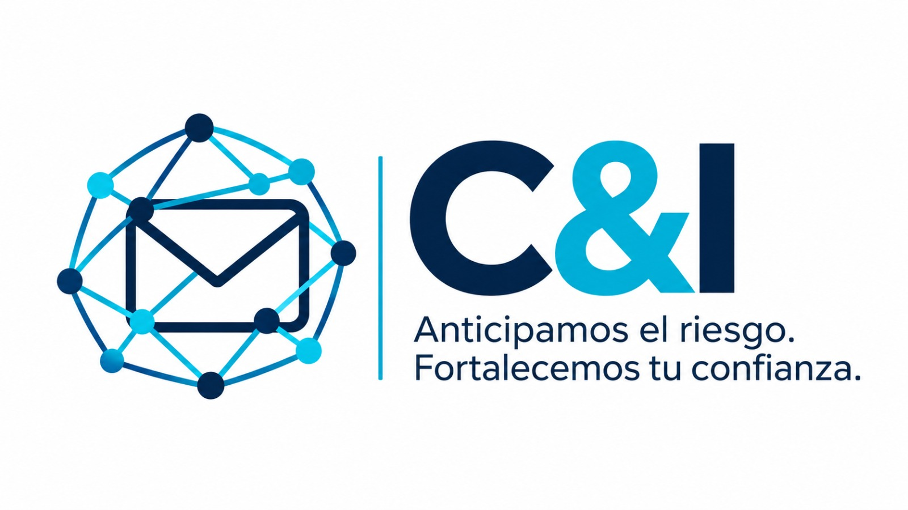

# 🛡️ C&I

Sistema inteligente contra el phishing en el correo corporativo de la banca venezolana.
Equipo **C&I – Creatividad e Innovación** · Hackathon UNETI IA 2026 · Proyecto #24 (+ #18).

> 🚧 En construcción durante el hackathon (13 y 14 de noviembre de 2026). Estado actual: **F0** (base del proyecto con contratos simulados).

## Qué hace
Analiza los correos que recibe el personal bancario, detecta phishing y suplantación, explica cada decisión con su fundamento legal y envía los correos peligrosos a spam o cuarentena, con revisión humana por roles.

## Cómo se instala
Requisitos: Node.js 20+ y Git.

    npm install
    cp .dev.vars.example .dev.vars
    npx wrangler d1 migrations apply c-i-db-offline --local --env offline
    npm run build:web
    npx wrangler dev --env offline

Abrir http://localhost:8787. El entorno `offline` funciona sin cuenta de Cloudflare y sin internet (usa el motor de reglas, sin IA).

Con Docker (prueba completa en una máquina limpia):

    docker compose up --build --abort-on-container-exit --exit-code-from smoke

## Cómo se usa
(se completa con los usuarios de demostración y el recorrido de la demo)

## Arquitectura Cloudflare usada
Workers (API con Hono) · D1 (buzón, usuarios y bitácora) · Workers AI (Llama 3.3 70B + Llama Guard 3) · Static Assets (frontend React + Tailwind).

## Uso de IA
Ver la declaración completa en [`SPEC.md`](SPEC.md). Resumen: las reglas deciden, la IA explica; nunca se envían datos personales reales al modelo.

## Enlaces
- Demo: (pendiente)
- Video: (pendiente)
- Presentación: (pendiente)

## Equipo
Anthony Leguisamo · Williams Mejía · Gabriel Flores · Alejandro Sánchez

## Para el equipo
- Documento maestro (PRD/TRD): [`docs/C&I.md`](docs/C%26I.md)
- Reparto de PR y ramas: [`docs/PLAN_PRS.md`](docs/PLAN_PRS.md)
- Plan de UX/UI: [`docs/PLAN_UX.md`](docs/PLAN_UX.md)
- Glosario: [`docs/GLOSARIO.md`](docs/GLOSARIO.md)
